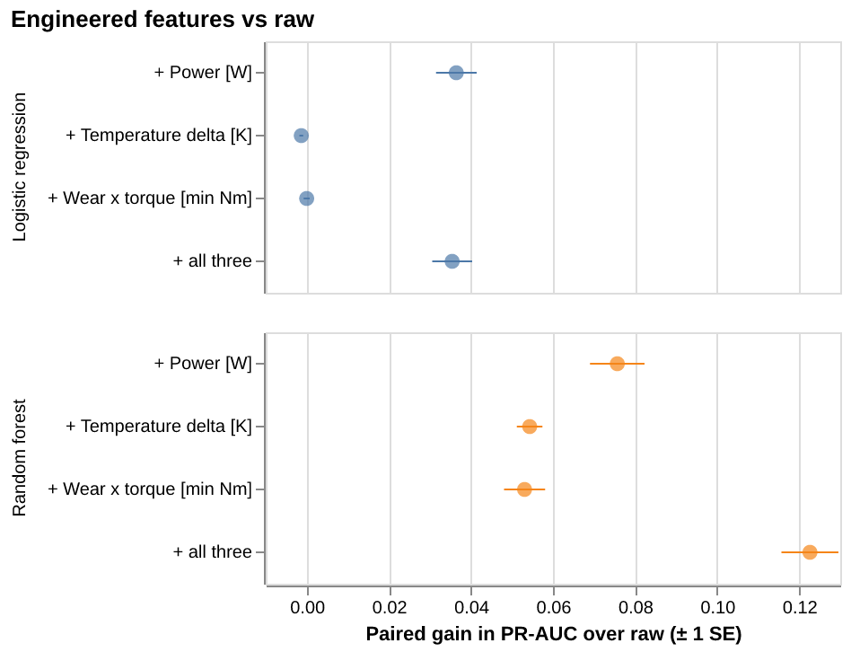
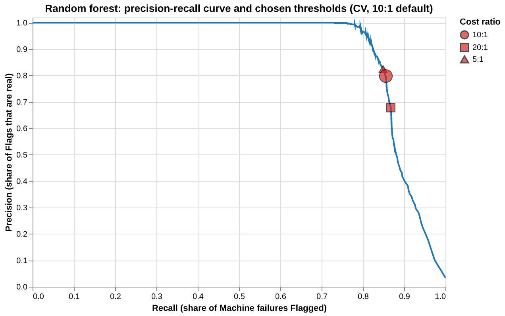

# Predictive Maintenance

[](https://github.com/suhaskv21/predictive-maintenance/actions/workflows/ci.yml)
[](https://github.com/suhaskv21/predictive-maintenance/actions/workflows/pages.yml)
[](https://suhaskv21.github.io/predictive-maintenance/)

**Live app: <https://suhaskv21.github.io/predictive-maintenance/>**

## Contents

- [Problem, users and outcome](#problem-users-and-outcome)
- [Setup, structure and execution](#setup-structure-and-execution)
  - [Project structure](#project-structure)
  - [Commands](#commands)
  - [Configuration and reproducibility](#configuration-and-reproducibility)
- [Key Technical Decisions](#key-technical-decisions)
  - [Decision evidence](#decision-evidence)
  - [Results on the Holdout](#results-on-the-holdout)
- [System design](#system-design)
- [Production-readiness critique](#production-readiness-critique)
  - [Data platform](#data-platform)
  - [Monitoring](#monitoring)
  - [Retraining and validation strategy](#retraining-and-validation-strategy)
  - [Deployment risks and a production frontend](#deployment-risks-and-a-production-frontend)
  - [Risks in full production and mitigations](#risks-in-full-production-and-mitigations)
- [Documents](#documents)

## Problem, users and outcome

A maintenance engineer has one machine's sensor values (product Type, air and process temperature,
rotational speed, torque, tool wear) and must decide whether to inspect it now. This system estimates a
**Failure risk** for that **Reading**, and raises a **Flag** ("Inspect")
when the risk reaches the model's own **Operating threshold**. The target is the recorded `Machine failure`.
It is an aid for prioritising inspections, not a guarantee.

**How predictions reach engineers.** The engineer opens the URL, enters the six inputs on one screen, and
reads a headline: *Inspect*, *No inspection flagged*, or *Not assessed* (an input is missing or impossible,
so no risk and no Flag are given, and the screen says that this does not mean the machine is fine). Beside
the headline are the Failure risk ("rough estimate, not calibrated"), 
description of what the "Flag" means and always-on caveats. 

**A useful outcome** is that engineers inspect the machines most likely to fail first, accept that some
inspections will find nothing, and never read "No inspection flagged" or "Not assessed" as a clearance.

## Setup, structure and execution

Requires Python 3.12 or newer, [uv](https://docs.astral.sh/uv/) and [just](https://just.systems/). The
commands run from a clean clone; `just` with no arguments lists every command.

### Project structure

Source lives in `src/predictive_maintenance/<stage>/` and tests mirror it under `tests/`. The app imports
`inference/` only and holds no preprocessing, threshold or wording logic. Working agreement:
[`AGENTS.md`](AGENTS.md).

```text
.
├── src/predictive_maintenance/   # all pipeline logic, one package per stage
│   ├── data/                     #   load and validate the raw CSV
│   ├── preprocessing/            #   feature building and imputation (fitted on train only)
│   ├── training/                 #   candidate models, training, provenance, writes models/
│   ├── evaluation/               #   split, model comparison, threshold, missing data, Holdout
│   ├── inference/                #   loads the unit and assesses one Reading (the only layer the app calls)
│   ├── deploy/                   #   stages and checks the static GitHub Pages build
│   ├── pipeline/                 #   the Stage contract and thin orchestrator (ADR 0002)
│   ├── monitoring/               #   placeholder: described in the design, not built
│   └── config.py                 #   loads configs/default.toml
├── marimo_app.py                 # the one-screen app; imports inference/ only
├── notebooks/                    # marimo notebooks: the evidence behind the ADRs
├── configs/                      # default.toml: the single seed and all tunable settings
├── data/raw/                     # ai4i2020.csv, committed and immutable
├── models/                       # trained unit (Pipeline, manifest, ...); git-ignored
├── reports/                      # holdout-metrics.json, the one committed Holdout result
├── docs/                         # adr/ (decisions), design/ (system design), agents/
├── tests/                        # mirrors src/ layout
├── justfile                      # task runner
└── .github/workflows/            # ci.yml (checks) and pages.yml (build and deploy)
```

### Commands

First run from a clean clone: `just install && just check && just train && just marimo-app`.

| Command | What it does |
|---|---|
| `just install` | Installs runtime and dev dependencies (`uv sync`; versions pinned to marimo's Pyodide). |
| `just check` | Runs ruff, ruff format check, mypy (strict) and pytest. Must pass before any change is done. `just test`, `just lint` and `just typecheck` run its parts on their own; `just format` auto-fixes. |
| `just train` | Trains the random forest on the train partition only (about 20 s), re-derives the Operating threshold by repeated CV and **fails** if it differs from the accepted threshold by more than the tolerance (both in the `[deploy]` table of `configs/default.toml`), then writes the five-file unit to `models/` (Pipeline, OperatingPoint, missing-data policy, operating-metrics, manifest with the Git commit, SHA-256 and library versions). `models/` is git-ignored and never committed. |
| `just holdout` | One-off: scores the Holdout once with the frozen threshold and writes `reports/holdout-metrics.json`. The report is already committed, so a second run **refuses**. Rescoring needs `--rescore` |
| `just holdout-check` | Fails with "holdout figures belong to a different model" if the report's hash is not the Pipeline in `models/`. Never rescores. |
| `just holdout-apply` | Checks the report, then labels the unit's operating-metrics `holdout`, with intervals. The build does this after training. |
| `just marimo-app` | Runs the app locally in app mode. Needs `just train` first. |
| `just site` | Rehearses the Pages build into `build/site`, as CI does. Needs `just train` first. |
| `just notebook` | Opens the marimo notebooks (evidence behind the ADRs; the pipeline never depends on them). |

### Configuration and reproducibility

- **Seeds.** One source: `seed = 42` in [`configs/default.toml`](configs/default.toml); every random
  component derives from it (the bootstrap uses seed stream 11 of it). Other settings are documented in
  [`configs/README.md`](configs/README.md).
- **Data.** `data/raw/ai4i2020.csv` must be present, with the 14 columns and no nulls; loading fails
  with a validation error otherwise.
- **Reproducibility.** A fresh local `just train` produced a Pipeline with the same SHA-256 as the CI build,
  so the Holdout report matches both. Training refuses a dirty Git tree and records the commit it ran from in
  the manifest (ADR 0015); to reproduce a model, check out that commit, `uv sync` and `just train`.
  `python -m predictive_maintenance.training.train --allow-dirty` trains from uncommitted changes for local
  experiments; the unit then records no commit and the build contract rejects it.

## Key Technical Decisions

| # | Decision | Choice | Justification |
|---|---|---|---|
| 1 | Target | Binary `Machine failure` (339 of 10,000, 3.39 %). | Chosen because only 339 failures are split across five overlapping modes (RNF has 19), too few to train "mode" predictions reliably. Predicting the *mode* is deferred, not rejected. |
| 2 | Features | `Type` (one-hot) and five sensors, plus three engineered features: Power (torque × angular speed), Temperature delta, Wear × torque. All are computed inside the serialized Pipeline. | Raw sensors miss the physical interactions behind failures (mechanical power, heat gap, wear under load), and with few failures a model struggles to learn them alone. Each feature was kept only if it raised the non-linear model's CV PR-AUC (random forest: +0.076, +0.054, +0.053); see Figure 1. |
| 3 | Excluded columns | The five Failure modes (`TWF, HDF, PWF, OSF, RNF`) and the identifiers `UDI` and `Product ID`. Never used as features for `Machine failure`. | The Failure modes are recorded outcomes ("any flag set" alone scores PR-AUC 0.93), so using them would leak the answer, and a new Reading does not have them. The identifiers carry no physics: the `UDI` signal is a row-position artifact (`UDI` 4001 to 5000 fail at 13.1 % against 2.3 % elsewhere). |
| 4 | Missing data | Strategy `reject`. Any absent or unusable input (absent, not a number, not finite, or physically impossible) means the Reading is **not assessed**: no risk, no Flag, no fallback score. Plausible ranges are in `configs/default.toml` (`[plausibility]`). | The training data has no missing values, so there is nothing to learn imputation from and `reject` is the simplest safe choice: a guessed value could hide a real failure behind a confident-looking score. A refusal-rate monitor (see Monitoring) flags if missing data becomes common, which would reopen the choice. |
| 5 | Split and validation | Stratified 70/30 split made once, before anything is fitted (the 30 % is the **Holdout**, about 102 failures). Model comparison and threshold choice use repeated stratified 5×5 CV on the train partition, with preprocessing fitted inside each fold. The Holdout is scored once. | Splitting before fitting anything prevents leakage. Stratifying guarantees the failure count in the Holdout, which matters at 3.4 % prevalence. With so few failures a single split is noisy, so repeated CV is used to rank close candidates. |
| 6 | Metrics | **PR-AUC** ranks models and **Brier score** checks the probability. Supporting: recall, precision, False alarms per caught failure, Flags per 1,000, ROC-AUC. Accuracy is not reported. | With only 3.4 % failures, accuracy is meaningless (flagging nothing is 96.6 % "right") and ROC-AUC is flattered by the many non-failures. PR-AUC focuses on the rare failures, and its no-skill value is the 3.4 % prevalence, not 0.5. The app shows a risk number, so Brier checks that the probability itself is trustworthy ([0007](docs/adr/0007-metric-and-threshold.md)). |
| 7 | Threshold and Cost ratio | Expected cost per 1,000 Readings at an assumed **Cost ratio** of 10 (one Missed failure counts as 10 False alarms), reported against *flag nothing* and *flag everything*. The Operating threshold is the median over CV repeats of the cost-minimising threshold, frozen before the Holdout. | A metric alone cannot say where to act, because a missed failure and a false alarm cost very different amounts. The threshold therefore minimises expected cost under an assumed ratio. The dataset has no costs, so the 10:1 ratio is an assumption that maintenance management can replace with the plant's real figure in `configs/default.toml`, then retrain. Figure 2 shows where the thresholds for 5, 10 and 20 sit. |
| 8 | Model | A non-linear tree ensemble: random forest (300 trees, unweighted, scikit-learn defaults), serialized with its preprocessing as one `Pipeline`. | The failure pattern is not linear. Logistic regression's binned residuals show systematic structure: it under-predicts at the extremes (top tool-wear decile 12.7 % observed against 7.2 % predicted) and over-predicts in the middle. A line cannot bend to these thresholds, while the forest's residuals stay near zero. Logistic regression was also far weaker (PR-AUC about 0.52 against 0.894). The forest, LightGBM and XGBoost were tied within selection noise, so the simplest strong model was kept. It serializes with its preprocessing and can be explained per Reading later with SHAP. |
| 9 | Output shown | *Inspect*: inspect the machine, and expect some Flags to be false alarms. *No inspection flagged*: carry on, but some real failures are not flagged. *Not assessed*: fix the input, or treat the machine as unassessed if a sensor is offline. | The model cannot be certain, so the wording must never read as a clearance or a guarantee. |

**Model choice and interpretability.** Candidates were compared on repeated CV PR-AUC,
simplest first. Logistic regression is readable but 0.37 PR-AUC lower (about 0.52 against 0.894), too weak to
prioritise maintenance. The random forest, LightGBM and XGBoost are within 0.03 of each other, a gap inside
the selection noise, so the forest was kept as the default. A tree ensemble also opens the way to per-Reading
explanations with SHAP, whose tree explainer computes each input's contribution to one Reading's score. SHAP
is a natural next step once the plant wants to see why a Reading was flagged,
and it needs only a dependency decision, with no change to the model. Until then, global permutation importance
ranks Torque, then Rotational speed, Air temperature, Tool wear,
Process temperature and `Type`, but it ranks inputs, not mechanisms. 

### Decision evidence

All figures use the train partition only (cross-validation); the Holdout is not used for any choice.
They are saved from the notebooks with `uv run --with vl-convert-python`, so the notebooks stay the source.



**Figure 1. Engineered features against raw sensors** ([notebook 01](notebooks/01_target_and_features.py)).
Each point is the mean paired PR-AUC gain over the raw sensors on identical folds (± 1 SE), for the random
forest (non-linear) and logistic regression (linear). All three features help the forest, the full set most
(about +0.12). For logistic regression only Power helps: Temperature delta is an exact
linear combination of two raw inputs, and Wear × torque adds almost nothing.



**Figure 2. Precision-recall curve and chosen thresholds** ([notebook 03b](notebooks/03b_threshold.py)).
Moving right catches more failures but more Flags are False alarms. The marks are the thresholds chosen at
Cost ratios 5, 10 (the default, large mark) and 20. A higher ratio moves the mark right. The 5 and 10 marks
nearly coincide (recall 0.85 and 0.86); 20 buys little more recall (0.87) for many more False alarms
(precision falls from 0.80 to 0.68).

### Results on the Holdout

Scored once, for one model, on the CI-built artifact (Pipeline SHA-256
`c55639bc96772158806b8201e61d845323508063feef1bb8954157940aef32b3`), on 2026-10-14. The Holdout has 3,000
Readings and 102 Machine failures. The Operating threshold (0.218) and the Cost ratio (10, an assumption)
were frozen before scoring. Intervals are percentile 95 % intervals from 2,000 stratified bootstrap
resamples, in which the threshold is never re-chosen. The committed source is
[`reports/holdout-metrics.json`](reports/holdout-metrics.json).

| Metric | Goal | Estimate | 95 % interval |
|---|---|---|---|
| Recall | Low missed-failure rate (higher is better) | 0.863 | 0.794 to 0.922 |
| Precision | Few false alarms among Flags (higher is better) | 0.830 | 0.766 to 0.899 |
| PR-AUC | Rank failures above non-failures (higher is better) | 0.914 | 0.867 to 0.955 |
| Brier | Trustworthy risk probability (lower is better) | 0.00696 | 0.00504 to 0.00909 |

Cross-validation on the train partition gave recall 0.856 and precision 0.798 at the same threshold, so the
CV figures were slightly more pessimistic on precision here. They are not the quoted figures; the Holdout is.

**Metric rationale and class imbalance.** Only 3.4 % of Readings fail, so a model that flags nothing is
96.6 % "right" and useless. Accuracy is therefore not reported, and the app is banned from quoting it.
PR-AUC (whose no-skill value is the 3.4 % prevalence, not 0.5) and the cost-based operating point carry the
evaluation. **Costs.** A *Missed failure* (false negative) is unplanned downtime, possible damage and a
rushed repair. A *False alarm* (false positive) is one unnecessary inspection. A higher Cost ratio lowers the
threshold, so more Readings are flagged and fewer failures are missed, at the price of more false alarms.
**The 10:1 ratio is an assumption, not a measurement.** The dataset has no costs, and maintenance management
should replace it with the plant's real figure (`default_cost_ratio` in `configs/default.toml`, then
retrain). The Flag meaning shown in the app quotes these Holdout figures, labelled as held-out test data, from the
first site build made after the report was committed; the footer's release tag tells you which build
you are looking at.

## System design

[System-design diagram](docs/design/system-design.md) (Mermaid): ingestion, training, serving and
monitoring. Built parts are solid and described-only production additions are dashed.

## Production-readiness critique

### Data platform

The demo reads one committed CSV of 10,000 Readings (`data/raw/ai4i2020.csv`), validated on load by
`data/clean`. That was the right choice for a small, public, immutable benchmark that must reproduce
offline, but **it is not production-ready**: a file in Git has no ingestion schedule, no history of what
changed, no access control and no way to trace a model back to the exact rows it was trained on.

A production system would instead need a managed database or warehouse that ingests Readings and maintenance
outcomes from the plant, with the data **versioned and tested** by a
transformation pipeline such as **dbt** (staging and mart models, schema and plausibility tests, snapshots
or dated tables for history). Training would read a pinned snapshot of that data, and the model manifest
would record the snapshot identifier next to the Git commit and SHA-256 it already records (ADR 0015), so any
model can be reproduced and any Holdout kept strictly separate from later data. Nothing of this is built;
it is shown dashed in the [system-design diagram](docs/design/system-design.md).

### Monitoring

The deployed site is static and keeps no log, so nothing below runs today. In production the system would
log one record per assessed or refused Reading (timestamp, model, status, missing inputs, and for each input
only a band against the training quartiles, never raw values) and compute:

1. **Refusal rate** - Refused readings (shown as "Not assessed") ÷ all Readings, daily and over a rolling four weeks. *Purpose:*
   under policy `reject` every missing input is a lost assessment, so a rise means a failing sensor or feed.
   Broken down by absent input and source, it separates one broken sensor from a spread-out problem, and it
   tells the team whether imputation would be worth building (triggers in ADR 0008).
2. **Flag rate against expected** - Flags ÷ assessed Readings, compared with the Holdout's 35.3 per 1,000
   (interval 31.7 to 39.0) at the 3.4 % training failure rate. *Purpose:* an early, label-free signal of
   input drift or a changed machine population. A rate far outside the band means "investigate", not
   "the model is wrong"; the real failure rate may differ from the benchmark's. Review bands are the plant's
   to set.
3. **Input drift** - how far each input (the five sensor values and `Type`) in recent Readings, for example
   the last week, has moved from what the model saw in training. *Purpose:* a warning that the machines or
   sensors no longer look like the training data, so the model's results deserve less trust. It is checked
   per input, so a shift points to the sensor behind it, and it needs no failure labels. A shift means
   "take a look", not "the model is wrong".


### Retraining and validation strategy

- **When:** on a schedule (for example monthly), or when monitoring flags sustained drift
  or a changed Flag rate, or when the Cost ratio changes (that moves the threshold).
- **Candidate:** refit with the same code and configuration on all labelled Readings up to a cutoff, and
  re-derive the Operating threshold. 
- **Validation:** score the candidate and the live model on a **fresh holdout** (Readings after the cutoff,
  never used for fitting or selection) with the same cost metric and intervals. The candidate must not be
  worse on expected cost, and its Flag meaning figures must be restated from that holdout.
- **Shadow period:** the candidate scores live Readings silently beside the live model. Flag rate,
  agreement and, as outcomes arrive, precision and recall are compared before it replaces the live model.
- **Promotion:** deploy to production after sufficient monitoring and human approval.

### Deployment risks and a production frontend

The dashboard is a prototype: a marimo app exported to a static site on GitHub Pages (built by `pages.yml`) that
runs the model in the visitor's browser. Its limits are that the model files are public, nothing is logged or
shared (so no monitoring), and the site rebuilds only on
demand. Production would replace it with a proper dashboard frontend over a hosted inference service, with
authentication and access control, server-side logging that feeds the monitoring above, and CI/CD with the
manifest and Holdout hash checks kept as release gates. 

### Risks in full production and mitigations

| Risk | Why it applies here | Mitigation |
|---|---|---|
| **Wrong decision cost** | The 10:1 missed-failure to false-alarm ratio is an assumption, and it sets the Operating threshold. | Replace it with the plant's real costs, retrain, and re-derive the threshold. |
| **Rare failures, delayed labels** | Only 3.4 % of Readings fail, so the Holdout metrics have wide intervals, and true outcomes arrive late. | Track precision and recall once outcomes are joined. Use a shadow period before promoting any model. |
| **Misreading the output** | Engineers may treat "No inspection flagged" as a clearance, or read the uncalibrated risk as a probability. | Keep the caveats on every screen, show "Not assessed" for bad or missing inputs, and add calibration. |
| **Silent degradation** | The demo keeps no logs, so nobody would notice if it drifted or broke. | Add server-side logging, alerts and retraining triggers. |
| **Security and availability** | The model files are public and the demo is a prototype frontend. | Use a hosted inference API with authentication, and a production dashboard with CI/CD and health checks. |
| **Data lineage** | A committed CSV cannot show which data a model was trained on. | Use a versioned warehouse (for example dbt) and record the data snapshot in the model manifest. |


## Documents

- [`TECHNICAL_SPEC.md`](TECHNICAL_SPEC.md): requirements.
- [`GLOSSARY.md`](GLOSSARY.md): terms (Reading, Flag, Failure risk, Operating threshold, Cost ratio, Holdout).
- [`configs/`](configs/README.md): settings.
- [`docs/adr/`](docs/adr/): every non-trivial decision with its evidence.
- [`reports/`](reports/README.md): the committed Holdout result.
