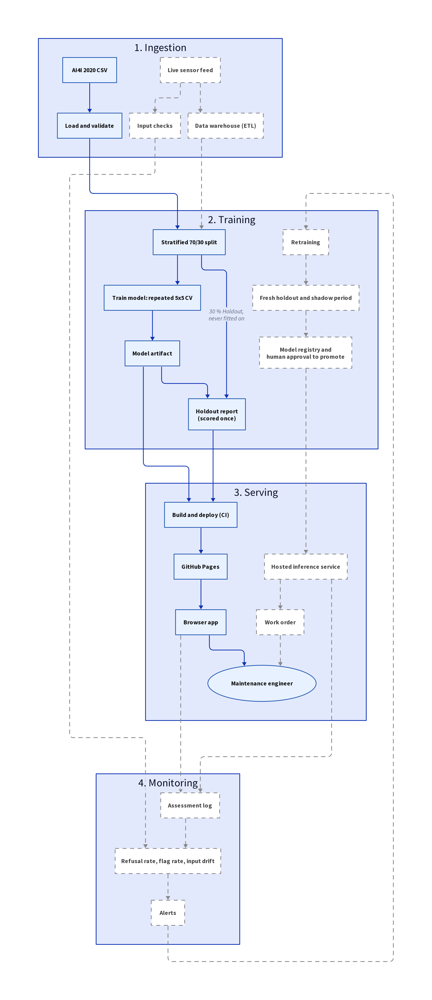

# System design

What is built for this submission (solid boxes and arrows) and what a production system would add
(dashed boxes and arrows, described only, nothing of it exists in the repository). Linked from the
[README](../../README.md). The scope that decides what is built is
[ADR 0012](../adr/0012-five-hour-submission-scope.md).

```mermaid
flowchart LR
    classDef built fill:#e8f1ff,stroke:#2b5fb4,stroke-width:1.5px,color:#111
    classDef prod fill:#fff,stroke:#888,stroke-width:1.5px,stroke-dasharray:6 4,color:#444

    subgraph ING["1. Ingestion"]
        CSV["AI4I 2020 CSV"]:::built
        LOAD["Load and validate"]:::built
        FEED["Live sensor feed"]:::prod
        VALID["Input checks"]:::prod
        WH["Data warehouse (ETL)"]:::prod
        CSV --> LOAD
        FEED -.-> VALID
        FEED -.-> WH
    end

    subgraph TRN["2. Training"]
        SPLIT["Stratified 70/30 split"]:::built
        TRAIN["Train model: repeated 5x5 CV"]:::built
        UNIT["Model artifact"]:::built
        REPORT["Holdout report<br/>(scored once)"]:::built
        RETRAIN["Retraining"]:::prod
        FRESH["Fresh holdout and shadow period"]:::prod
        REG["Model registry and<br/>human approval to promote"]:::prod
        LOAD --> SPLIT --> TRAIN --> UNIT
        WH -.-> SPLIT
        SPLIT -->|"30 % Holdout, never fitted on"| REPORT
        UNIT --> REPORT
        RETRAIN -.-> FRESH -.-> REG
    end

    subgraph SRV["3. Serving"]
        BUILD["Build and deploy (CI)"]:::built
        PAGES["GitHub Pages"]:::built
        INF["Browser app"]:::built
        ENG(["Maintenance engineer"]):::built
        API["Hosted inference service"]:::prod
        WO["Work order"]:::prod
        UNIT --> BUILD
        REPORT --> BUILD
        BUILD --> PAGES --> INF --> ENG
        REG -.-> API -.-> WO -.-> ENG
    end

    subgraph MON["4. Monitoring"]
        LOG["Assessment log"]:::prod
        MET["Refusal rate, flag rate, input drift"]:::prod
        ALERT["Alerts"]:::prod
        INF -.-> LOG
        API -.-> LOG
        LOG -.-> MET -.-> ALERT
        ALERT -.-> RETRAIN
        VALID -.-> MET
    end
```

## Reading the diagram

- **Solid, blue** boxes and arrows exist in this repository and run today. **Dashed, white** boxes and
  dashed arrows are production additions that are described only. The engineer is real; the dashed arrow
  into them is the work order, which is not built.
- **Ingestion** is a committed CSV, which is not production-ready. The built path validates the schema and
  integrity of the data. A live feed, a data warehouse and input checks are not built.
- **Training** is one command that touches only the train partition. The Holdout is scored once, from
  the CI-built artifact, and the report is committed. A scheduled retraining loop with a fresh holdout and
  a shadow period is the production counterpart (see the README's retraining strategy).
- **Serving** is a static site: Python runs in the visitor's browser (Pyodide), so there is no server. A
  hosted inference service and a work order are not built.
- **Monitoring** is not built. The refusal rate, the flag rate and input drift are defined in the
  README. An assessment log, a health tab and the Sample log are designed in ADRs 0008 to 0010 and
  deferred by ADR 0012.
